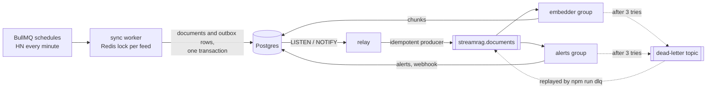
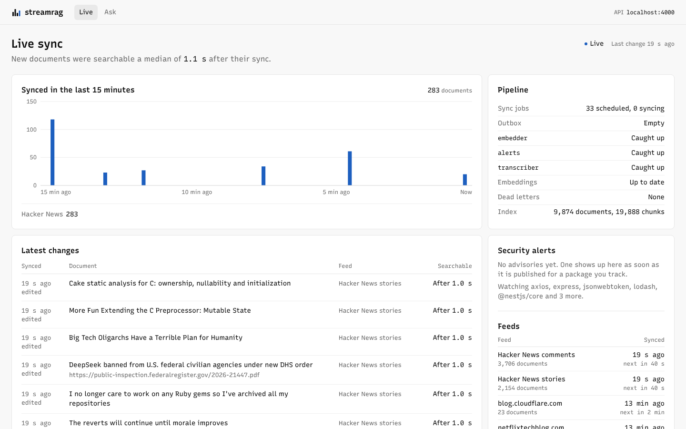
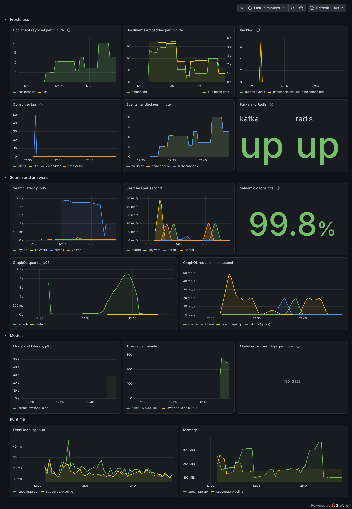

# streamrag

A real-time RAG engine. It keeps a constantly changing knowledge base in sync, searches it with hybrid keyword and vector search plus reranking, and answers questions from it with citations. Run as a streaming pipeline on Kafka, it makes new Hacker News comments searchable a couple of seconds after each one-minute poll finds them. It answers through a CLI, a GraphQL API that streams, an MCP server for coding assistants and a LangGraph agent that looks things up before it answers. A Next.js dashboard shows documents arriving and becoming searchable as it happens. OpenTelemetry traces, Prometheus metrics in Grafana, Langfuse for the model calls and k6 load tests show what it's doing and how much it takes.

It ships with four kinds of sources: engineering blogs and release notes over RSS, Hacker News as a live stream, a dependency radar that follows the release notes and security advisories of every package in your `package.json`, and developer podcasts, transcribed locally with FFmpeg and Whisper so search can land on the minute a topic comes up.

Everything runs on free, open-source tools, including the models. Answers come from a model on your own machine through Ollama, and the free tiers of Gemini and Groq can be added as fallbacks.

## What works today (phases 1 to 8)

- Connectors for RSS and Atom feeds, Hacker News (through its Algolia API) and OSV.dev security advisories. The default `sources.json` follows 30 engineering and release blogs plus the latest Hacker News stories and comments, about 5,600 documents on a first run.
- Dependency radar. `npm run track -- path/to/package.json` adds each dependency's security advisories and, when the package lives on GitHub, its release notes.
- Incremental sync. A content hash skips unchanged documents and catches edited ones. Snapshot sources list everything that exists, so whatever they stop listing gets closed. Append-only feeds like RSS and Hacker News keep items open after they roll off. A source that fails to fetch is skipped and left as it was.
- Incremental embedding. Only new or changed documents get re-chunked and re-embedded, a batch at a time, so an interrupted run resumes where it stopped.
- Hybrid search with reranking, measured by an eval set (below).
- Answers with citations. `npm run ask` streams an answer written from the top six search results and lists the sources it cites.
- An LLM gateway with retries, fallback across providers, a circuit breaker and per-minute rate limits. Every model call is logged, and `npm run usage` sums them up.
- A semantic cache. The same question asked again, even lightly reworded, gets the earlier answer back in under a second, as long as the documents it cites haven't changed.
- What breaks when you upgrade. `npm run upgrade -- express 4.21.0 5.0.0` reads the release notes of every major and minor release in between, has the model pull out the breaking changes as JSON, and stores them, so a release is only read once.
- An LLM eval with promptfoo that scores the model on both jobs: cited answers and reading breaking changes out of release notes.
- A streaming pipeline. `npm run pipeline` syncs each source on its own BullMQ schedule, writes every change and its event in one transaction (the outbox pattern), publishes the events to Kafka, and lets consumer groups embed new documents and alert on new security advisories, with a dead-letter topic for events that keep failing.
- APIs. `npm run serve` is a GraphQL API whose answers stream as server-sent events, and `npm run mcp` is an MCP server, so Claude Code, Claude Desktop or Cursor can search your sources and check upgrades and advisories while they work.
- An agent. `npm run agent` is a LangGraph graph around native tool calling: the model calls `breaking_changes`, `security_advisories` or `search`, reads the results and answers, and each thread remembers its earlier questions.
- A live dashboard. `web/` is a Next.js app that shows each document as its sync commits and again when it becomes searchable, with how long that took, next to the pipeline's backlog, new security alerts, each feed's next sync and the model calls. Its Ask page streams cited answers and the agent's tool calls.
- Observability and load tests. The API and the pipeline send OpenTelemetry traces to Jaeger, and the model calls go to Langfuse as generations. Prometheus scrapes both processes and Grafana opens on a streamrag dashboard. `npm run load` runs k6 scenarios against the API.
- Podcasts and talks. Any RSS item with an audio file is an episode. `npm run transcribe` streams it through FFmpeg into Whisper and stores a transcript with a time mark about every 30 seconds, so search results and citations link to the moment (`episode.mp3#t=1262`). In the pipeline, new episodes get transcribed as they arrive.

## Quick start

Needs Node 22.22+ and Docker, plus [Ollama](https://ollama.com) for answers and [FFmpeg](https://ffmpeg.org) for podcasts.

```bash
npm install
docker compose up -d                      # Postgres, Redpanda (Kafka) and Redis
npm run migrate
npm run ingest                            # sync, then embed what changed
npm run search -- "how do teams avoid cache stampedes"
ollama pull llama3.2:3b                   # the default answer model, about 2 GB
npm run ask -- "how does Cloudflare D1 scale to millions of databases?"
npm run agent -- "what breaks if I upgrade express from 4.21.0 to the latest version?"
npm run upgrade -- express 4.21.0 5.0.0   # what breaks between two versions
npm run transcribe                        # the newest podcast episode; npm run ingest then embeds it
npm run usage                             # model calls, errors, latency and tokens
npm run track -- ../my-app/package.json   # then run npm run ingest again
npm run eval                              # score every search mode
npm run eval:llm                          # score the model with promptfoo
npm run pipeline                          # keep everything in sync as events; Ctrl+C stops it
npm run status                            # outbox backlog, Kafka lag, dead letters, sync jobs
npm run serve                             # GraphQL, with GraphiQL at http://localhost:4000/graphql
npm run mcp                               # MCP server over stdio, for coding assistants
docker compose --profile observability up -d   # Prometheus, Grafana and Jaeger
SCENARIO=search MODE=hybrid npm run load  # k6 against the running API
cd web && npm install && npm run dev      # the dashboard at http://localhost:3000, while npm run serve runs
```

The first `ingest` downloads two small models (about 56 MB, kept in `node_modules`) and embeds every document once. For the default sources that's about 15,000 chunks, which took around half an hour on a 2-core machine and goes faster with more cores. After that, each run only embeds what changed.

`npm run search` takes `--mode keyword|vector|hybrid|rerank` (default `rerank`) and `-n` for the number of results.

Settings live in an optional `.env` file, and `.env.example` lists them: another Ollama model or address, Gemini and Groq keys and the order to try providers in, a GitHub token, the Kafka and Redis addresses, and a webhook for alerts.

## How search works

1. Each document is split into overlapping ~200-word chunks, and every chunk starts with the document's title, so it still says what it's about when retrieved alone.
2. Every chunk gets a 384-dimension embedding from `bge-small-en-v1.5`, stored in pgvector with an HNSW index, and a `tsvector` with a GIN index.
3. A query runs both legs and fuses their rankings with reciprocal rank fusion in one SQL statement. Each leg contributes `1 / (60 + rank)`, so a chunk both legs agree on wins, and raw scores from the two legs, which aren't comparable, never get mixed.
4. A cross-encoder (`ms-marco-MiniLM-L-6-v2`) reads the query together with each of the top 30 chunks and reorders them. It is slower than comparing embeddings but much better at judging relevance.
5. Results come back as documents, each with its best chunk.

Both models run on the CPU through transformers.js, with no API keys.

## How answers work

1. The question goes through the same reranked search. The top six results, one chunk from each document, become numbered sources in the prompt, around 1,700 tokens in all.
2. The model is told to cite every claim as `[n]` and to say so when the sources don't answer the question. The answer streams to the terminal as it's written, and citations to numbers that weren't in the prompt are dropped and reported.

A gateway sits between `ask` and the models:

- It tries providers in the order of `LLM_PROVIDERS`: Ollama first by default, then Gemini and Groq, each only when its key is set.
- A 429, a 5xx or a reset connection gets up to three attempts, with exponential backoff and full jitter, waiting at least as long as `Retry-After` asks. After a bad key, a refused connection or a `Retry-After` over 10 seconds (a free quota that's used up), it moves on to the next provider at once.
- Switching provider is only safe before the first token. Once text has streamed, a failure ends the answer with an error, because a second provider would start the answer over.
- Three failed calls in a row take a provider out of rotation for 30 seconds.
- A sliding one-minute window keeps each free tier under its request limit. A request that would wait more than 2 seconds for a slot goes to the next provider instead.
- Every call, error and skip lands in the `llm_calls` table, which `npm run usage` sums over the last week.

The cache embeds each question and looks for one asked in the last day within cosine distance 0.05. A hit only counts while every document the answer cites is still open with the same content hash, so an edited release note or a withdrawn advisory forces a fresh answer. Answers that cite nothing aren't cached, because "the sources don't say" can stop being true after the next sync.

On the live corpus, a reworded question ("how does cloudflare's D1 scale to millions of databases") was 0.012 away from the cached one and hit. Questions about something else, like "How does Cloudflare D1 handle backups?" or "How does Turso scale to millions of databases?", were 0.18 or more away and missed. A heavier rewording at 0.11 missed too. The threshold is tight on purpose, since a miss costs one model call and a wrong hit serves a confident answer to a different question.

On 2 CPU cores with no GPU, Llama 3.2 3B took about a minute per answer, around 50 seconds of it spent reading the prompt, and a cached repeat took under a second. In test questions it cited its sources whenever it answered from them, and said plainly when they didn't cover the question. Qwen 2.5 0.5B, tried for comparison, never cited anything, so none of its answers could be cached.

Gemini and Groq keys are free to create. Leave billing off on both accounts and they can't charge you. When a free quota runs out, the gateway moves on to the next provider. Google may use what you send to the free Gemini API to improve its products, which is fine for public blog posts but worth knowing.

## What breaks when you upgrade

1. npm supplies the version list and the GitHub repo. The releases to read are the stable majors and minors after the version you're on, up to the one you name (the latest by default). Patch releases are skipped: semver keeps breaking changes out of them, and a big project ships dozens.
2. Release notes come from the repo's releases feed, which carries the newest ten, and older ones from GitHub's API by tag (`v5.0.0`, `5.0.0` or `express@5.0.0`). Without a token the API allows 60 requests an hour, which goes a long way since each release is fetched once; a `GITHUB_TOKEN` raises the limit. Fetched notes are ordinary documents, so the next `ingest` makes them searchable too.
3. The model reads the notes in pieces of up to 4,000 characters, cut between lines, with link targets stripped, since commit URLs are most of the tokens in a changelog. It has to answer with JSON in a fixed schema, `{"breaking": [{"change", "migration"}]}`. Ollama, Gemini, Groq and llama.cpp constrain their output to the schema, the reply gets checked anyway, and one that doesn't parse gets a single retry.
4. The results go into `breaking_changes`, and `extracted_hash` records which version of the notes they came from, the same way `embedded_hash` works for chunks. Edited notes get read again, and nothing else is ever sent to a model twice.

Notes that only point to a changelog file are flagged as too short to judge. Projects that spread a major's breaking changes over its betas only get what the final release's notes say; Express 5 is one of them.

## The streaming pipeline

`npm run ingest` is the batch way in: sync everything, embed what changed, exit. `npm run pipeline` keeps running and does the same work as a stream of events.



1. BullMQ keeps one job scheduler per source in `sources.json`: Hacker News every minute, blogs every 15 minutes, advisories every 6 hours, or whatever an `every` field (in milliseconds) says. A worker syncs one feed per job, at most one a second, and retries a failed fetch with backoff.
2. Each sync first takes a Redis lock on its feed (`SET NX PX` with a random token, released by a Lua compare-and-delete), since two syncs of one feed at once could close each other's documents.
3. The sync writes its documents plus one outbox row for every document it added, changed or closed, in the same transaction. An event exists exactly when its change committed: a failed sync leaves none behind, and none can be lost after a commit.
4. The relay wakes on `pg_notify` from that transaction, and every 5 seconds in case a notification was missed. It publishes the rows with an idempotent producer, keyed by document id so one document's events stay in order, and marks them published. A crash between publishing and marking sends them again, so delivery is at least once and the consumers have to cope with repeats.
5. Two consumer groups read the topic and commit an offset only after handling its event:
   - The embedder embeds the current version of every document the events name, up to 64 at a time. It compares content hashes, so a repeated or outdated event does nothing.
   - The alerts group records each new security advisory once, for feeds past their first sync. An alert isn't naturally repeatable the way an embedding is, so a `processed_events` row is written in the same transaction as the alert. With `ALERT_WEBHOOK_URL` set, the alert goes to Slack or Discord too.
6. An event that fails three times, with backoff, goes to `streamrag.documents.dlq` with its error, and the partition moves on. A failed batch is first redone one event at a time, so only the bad event ends up there. `npm run dlq` lists dead letters, and `npm run dlq -- --replay` sends them back once the bug is fixed; every consumer sees them again, which is safe because every consumer is idempotent.

`--only relay,embedder` runs a subset of the roles, so each can run as its own process, and extra embedder processes split the topic's three partitions between them. `npm run status` shows the outbox backlog, how far behind each group is, the dead letters not yet replayed, and the sync jobs.

On 2 CPU cores, a Hacker News poll that found 28 new comments had them embedded and searchable 2 seconds later. A backlog of about 300 documents went through in batches of 64 at roughly 5 a second, while a local model was busy on the same CPU.

The pipeline tests start Postgres, Redpanda and Redis with Testcontainers and check each of these guarantees, from a failed sync leaving no events to a dead letter replaying exactly once. With a stand-in embedder, a sync commit is searchable about 200 ms later.

## Podcasts and talks

1. The RSS connector treats an item with an audio enclosure as an episode and keeps its length from `itunes:duration`. The default sources include Software Engineering Daily; conference talks work the same way wherever there's an audio feed, like media.ccc.de's per-congress MP3 feeds.
2. FFmpeg reads the episode straight from its URL, in whatever format, and writes 16 kHz mono 32-bit float samples to stdout: `ffmpeg -i <url> -vn -ac 1 -ar 16000 -f f32le pipe:1`. They arrive in five-minute blocks, so a three-hour episode never sits in memory whole, and `--minutes` stops the download early. FFmpeg stops reading while Whisper works through a block, which is long enough for a CDN to drop the connection, so it runs with `-reconnect 1` and asks for the rest with a range request. A transcript that still ends more than 2% short of the feed's `itunes:duration` fails instead of being stored, so it gets retried.
3. Whisper (`whisper-base.en` through transformers.js, on the CPU) turns each block into timed segments. Those get merged into paragraphs of about 30 seconds, each opening with its start time, so any chunk of a transcript says roughly where in the episode it is.
4. The transcript is a document of its own, keyed like its episode, so sync, embedding, search and answers handle it with no special cases. Its URL is the audio file, and a search hit turns the first time mark in its chunk into a media fragment (`#t=1262`) that starts playback there.
5. In the pipeline, a transcriber group handles new episodes as they arrive. A feed's first sync doesn't count, so adding a podcast doesn't queue its whole back catalogue; `npm run transcribe -- -n 5` does those on request.

A 49-minute SED News episode came out at 9,588 words in 18.5 minutes on 2 CPU cores, about 2.6 times faster than real time, using about 1.9 GB of memory. Before the reconnect, the same episode stopped at 9 minutes and was stored as if that were all of it. In an earlier 47-minute episode on software verification, searching "branching timelines after a node crashes to explore different orders of events" landed at 21:02, where the guest walks through it.

Moving to transformers.js 4 made Whisper about 30% slower here, and on the same 10 minutes of audio it also found 10% more words, because 3.8 dropped the last seconds of each block.

With the 3B model, an answer drawn from a transcript sometimes cites the episode's show notes instead, since the two share a title. `WHISPER_MODEL=Xenova/whisper-base` handles talks in other languages, and `whisper-tiny.en` is a little faster and less accurate.

## APIs and the agent

`npm run serve` starts a GraphQL API (GraphQL Yoga) at `http://localhost:4000/graphql`, with GraphiQL on the same URL. Queries cover `search`, `upgrade`, `alerts` and `status`. Two subscriptions stream over server-sent events, so plain `fetch`, `curl` or an `EventSource` can read them as they're written:

- `ask` sends the numbered sources, then each token, then which sources the answer cited.
- `agent` sends each tool call as the agent makes it, then the answer's tokens. Passing the same `thread` again asks a follow-up.

```bash
curl -N http://localhost:4000/graphql -H 'content-type: application/json' -H 'accept: text/event-stream' \
  -d '{"query":"subscription { ask(question: \"How does Cloudflare D1 scale?\") { ... on AnswerToken { text } } }"}'
```

`npm run mcp` is an MCP server over stdio with three tools, the same ones the agent uses:

- `search`: everything synced, with links.
- `breaking_changes`: what breaks between two versions of an npm package.
- `security_advisories`: OSV advisories for a package, or only those that affect a given version.

To add it to Claude Code, run `claude mcp add streamrag -- node /path/to/streamrag/src/mcp.ts`. For Claude Desktop, add it under `mcpServers` with `"command": "node"` and `"args": ["/path/to/streamrag/src/mcp.ts"]`. The assistant's own model does the reasoning, and streamrag supplies what it knows about the code's dependencies.

The agent (`npm run agent`, or the subscription) is a LangGraph graph of two nodes. The model node calls the gateway with the tools' JSON schemas, which come from the same zod definitions the MCP server registers. A conditional edge sends any tool calls to the tool node, which runs them in parallel and returns the results, and the loop repeats until the model answers. A call that fails, whether to a tool that doesn't exist or with arguments that don't validate, comes back to the model as a readable error rather than ending the run. After three rounds of tool calls on one question the tools are withheld, so a model that keeps calling them still has to answer. A checkpointer keeps each thread's messages.

Tool calling goes through the same gateway as everything else, with the same retries and fallback. The client puts streamed tool-call fragments back together, which Ollama, Gemini, Groq and llama.cpp all send in the OpenAI format.

Llama 3.2 3B on 2 CPU cores answered "What breaks if I upgrade express from 5.0.0 to the latest version?" in about three minutes. It made three tool calls and came back with no breaking changes in 5.1.0 through 5.3.0, no advisories for 5.0.0, and a link to the release notes. The first tries showed what a small model sends: `"to": "latest"` and `"limit": "5"` as a string, so the tools now accept both. Each tool result also opens with a one-line verdict now; before that, the model's answer skipped what the tool had found and suggested searching instead.

## The dashboard

`web/` is a Next.js app with two pages. With the API running (`npm run serve`):



```bash
cd web
npm install
npm run dev       # http://localhost:3000; or npm run build && npm start
```

It talks to `http://localhost:4000/graphql`, from the Next.js server for the first render and from the browser after that; `API_URL` points it somewhere else.

- Live: one line under the title says what matters most right now: the stage that's stuck and the command that unsticks it, or else how quickly new documents turned searchable. Bars for every 10 seconds of the last 15 minutes show what synced; Hacker News, polled every minute, keeps the beat. A bar that lands while its documents are still being embedded is grey and fills in once they're searchable. Below it, each document a sync adds, changes or closes appears as the sync commits, and its Searchable column turns from Waiting to the time it took. Rows embedded before the page opened get that time from the API, which stores when each document's chunks were written. Beside them are the pipeline's stages in the order a document passes through them (sync jobs, outbox, each Kafka consumer, embeddings, dead letters, the index), security alerts as they're raised, each feed's last and next sync, and the model calls of the last week with p95 latency and tokens. Figures are set in Recursive's monospaced style, words in its sans; colour marks only the arriving data and whatever is wrong.
- Ask: a streamed answer whose `[n]` citations link to their sources, or the agent, which lists its tool calls as it makes them and keeps the conversation for follow-ups. It can also just search.

How a change gets to the browser:

1. A sync sends a `NOTIFY` with the ids of its outbox rows, inside the transaction that writes them, so the notification goes out exactly when the change commits and not at all if it rolls back. The embedder does the same when it commits chunks, and the alerts consumer when it commits an alert. Ids go 500 to a notification, under Postgres's 8,000-byte payload limit.
2. The API keeps one `LISTEN` connection, reads the rows each notification names, and fans the events out to every client of the `activity` subscription over server-sent events. It handles one notification at a time, so the feed keeps commit order, and listens again two seconds after its connection drops.
3. The page is rendered on the server with the current state (React Server Components), and the browser then follows the stream with `fetch`. When the stream drops, the page says it's reconnecting, retries with backoff, and reloads recent activity once it's back, since whatever committed in between was never sent.

The status, feeds and model usage are polled, every 5 to 60 seconds.

With the pipeline running on the live corpus, a document synced by hand appeared in the browser within 0.3 seconds of starting the sync and was searchable 0.1 seconds after its commit, by way of the relay, Kafka and the embedder. A first poll that brought in 251 Hacker News comments took about a minute to clear, 64 at a time.

`cd web && npm test` builds the dashboard and runs Playwright against it and the real API on a Testcontainers Postgres, with stand-in models. The tests check the first render, a sync appearing and turning searchable, a new alert, the page explaining how to start the API while it's down and reconnecting when it's back, and answers, agent follow-ups and search. With the live stream ignored on purpose, the three live tests fail.

## Observability and load testing

```bash
docker compose --profile observability up -d   # Prometheus, Grafana and Jaeger, on localhost only
# .env: OTEL_EXPORTER_OTLP_ENDPOINT=http://localhost:4318
npm run serve
npm run pipeline
```



- Grafana (http://localhost:3001) opens on the streamrag dashboard: documents synced and embedded per minute, the outbox and embedding backlog, consumer lag, events by outcome, search latency by mode, GraphQL latency by operation, the semantic cache's hit rate, model latency, tokens and errors, and event loop lag and memory.
- Prometheus (http://localhost:9090) scrapes the API at `:4000/metrics` and the pipeline at `:9465/metrics`. The counters come from prom-client and are counted in whichever process does the work. The backlog gauges are read from Postgres, Kafka and Redis when Prometheus scrapes, so the outbox keeps showing up while the pipeline is down.
- Jaeger (http://localhost:16686) has the traces. `src/telemetry.ts` is loaded with `--import` before anything else and starts OpenTelemetry with instrumentation for HTTP, fetch, Postgres and Redis. streamrag adds spans for its own work: sync jobs and syncs, relay publishes, consumer batches, embedding, searches (with the query embedding and the rerank inside them), answers, agent runs and tool calls, and every model call.

Three details that took some care:

1. A change keeps its trace across processes. A sync writes its `traceparent` into each outbox event, and the relay's publish span and each consumer group's batch span link back to the syncs whose events they carry.
2. An async generator runs in the context of whoever calls `next()`, not of whoever created it, so the spans of a streamed answer came loose from it at first. A small helper drives the generator inside the right context, which keeps an answer's search, model call and fetch in one trace.
3. Queries, Redis commands and fetches are only traced inside an operation. Otherwise BullMQ's polling and the relay's checks would start a trace every few seconds.

### Langfuse

```bash
docker compose --profile langfuse up -d        # http://localhost:3030, sign in as admin@streamrag.local / streamrag-local
# .env:
LANGFUSE_PUBLIC_KEY=pk-lf-streamrag-local
LANGFUSE_SECRET_KEY=sk-lf-streamrag-local
LANGFUSE_BASE_URL=http://localhost:3030
```

Langfuse gets the same OpenTelemetry spans, as OTLP JSON, filtered to the model work: answers, agent runs, tool calls and model calls. Model calls follow OpenTelemetry's GenAI conventions (`gen_ai.request.model`, `gen_ai.usage.input_tokens`, `gen_ai.prompt`, `gen_ai.completion`), which Langfuse shows as generations with their prompt, reply, tokens and latency. Tool calls show up as tools, and each agent thread becomes a Langfuse session. The self-hosted stack is six containers (web, worker, Postgres, ClickHouse, MinIO and Redis). Langfuse Cloud's free plan works the same way with its own keys and `LANGFUSE_BASE_URL=https://cloud.langfuse.com`.

Checked against Langfuse 4.64 with a local model: an answer arrived as an `answer` span holding one generation with its prompt, reply and token counts, and an agent question about lodash 4.17.20 as an `agent` span in its thread's session, with the model call that chose `security_advisories`, the tool call, and the call that wrote the answer.

### Load testing

`npm run load` runs `load/k6.js` with k6 in Docker against the API (`k6 run load/k6.js` does the same with k6 installed). `SCENARIO` picks what to load: `search` with `MODE=keyword|vector|hybrid|rerank`, `dashboard` for the queries the live page polls, or `cached` for an answer the semantic cache serves. `RATE` is requests a second, held for a minute after a 10-second ramp.

On a 2-core, 8 GB cloud VM, with the pipeline running and traces going to Jaeger, over about 9,900 documents in 19,900 chunks:

| scenario | asked | served | median | p95 | errors |
|---|---|---|---|---|---|
| keyword search | 50/s | 46.5/s | 7 ms | 18 ms | 0 |
| vector search | 20/s | 18.6/s | 20 ms | 39 ms | 0 |
| hybrid search | 20/s | 18.6/s | 21 ms | 38 ms | 0 |
| rerank search | 1/s | 1.0/s | 1.09 s | 1.47 s | 0 |
| rerank search | 5/s | 4.6/s | 38 ms | 2.1 s | 0 |
| dashboard queries | 20/s | 18.6/s | 5 ms | 12 ms | 0 |
| cached answer | 20/s | 18.6/s | 17 ms | 34 ms | 0 |

The served rate includes the 10-second ramp, which is why 20 a second shows as 18.6.

Reranking is the expensive step: the cross-encoder takes about a second for 30 chunks on 2 cores. At one search a second, every search was reranked. At five a second, about one a second still was, and the other 78% (259 of 330) kept the hybrid order instead of waiting, so the median stayed at 38 ms and nothing timed out. Before the queue, two rerank searches a second piled up until 32% of them hit k6's 60-second timeout.

The Playwright tests that drive the dashboard are described above.

## Eval

`npm run eval` starts its own Postgres in Docker, pulls the current OSV advisories for 40 popular npm packages, embeds them, and asks 56 questions in every mode. The questions are written the way a developer would ask them, mostly without the advisory's own wording, and each lists the advisories that answer it. A few are bare CVE IDs, which keyword search is good at and embeddings are not.

Results on 557 advisories, October 2026:

| mode | recall@1 | recall@5 | recall@10 | MRR@10 |
|---|---|---|---|---|
| keyword | 0.11 | 0.14 | 0.14 | 0.13 |
| vector | 0.88 | 0.95 | 0.95 | 0.90 |
| hybrid | 0.88 | 1.00 | 1.00 | 0.92 |
| rerank | 0.88 | 1.00 | 1.00 | 0.93 |

Recall@k is the share of questions whose answer shows up in the top k results. MRR rewards putting it first. The corpus grows as new advisories are published, so the numbers move a little over time.

The models now embed one text per call instead of padded batches of 16 (see How it's built). That changed the vectors slightly, and on the same 557 advisories it moved vector search's recall@5 from 0.91 to 0.95 and hybrid's from 0.96 to 1.00. With that and transformers.js 4, the whole eval runs in under four minutes, down from ten.

Keyword search on its own needs every word of a question in one chunk, so it rarely finds an answer to a natural question. Inside hybrid search the strictness helps: it fires on exact names and IDs, which the vectors miss, and lifts recall@10 from 0.95 to 1.00.

Two changes the eval decided:

- Matching any word instead of all of them lifted keyword search alone from 0.14 to 0.77 recall@10, but dropped hybrid from 1.00 to 0.93 and its MRR from 0.91 to 0.74, because fusion trusts a noisy leg as much as a precise one. It was reverted.
- The reranker pushed bare CVE IDs out of the top 10, since it was trained on natural questions. Queries that look like an identifier now keep the hybrid order, which brought rerank's recall@10 from 0.96 to 1.00. Those IDs still land second or third rather than first.

### LLM eval

`npm run eval:llm` uses promptfoo to score the model on the two jobs it has:

- Answers: eight of the questions above, over the same advisories, plus two that no npm advisory can answer. An answer passes when it cites an advisory that answers the question and no source number it wasn't given. For the two unanswerable questions, it passes by citing nothing.
- Extraction: four changelog sections pinned at release tags. Express 5.0.0 and ESLint 9.0.0 have breaking changes the model should find; the patch releases Express 5.0.1 and 4.21.1 have none.

Llama 3.2 3B, October 2026:

| suite | passed | score |
|---|---|---|
| answers with citations | 9/10 | 0.95 |
| breaking changes from release notes | 4/4 | 1.00 |

The one miss cited a different follow-redirects advisory than the one the question describes.

The first extraction run passed 2 of 4. The model called a CVE fix in Express 5.0.1 breaking, and listed a single item for ESLint 9, which has 38 breaking changes, because a small model copies long lists badly. Two changes followed:

- The prompt now says security fixes don't count either, unless the notes say behavior changes. That fixed Express 5.0.1.
- Lines that conventional commits mark as breaking (`feat!:`, `BREAKING CHANGE:`) are taken straight from the notes, and the model only judges the rest. ESLint 9 passed after that, and the run got a third faster.

`EVAL_MODELS=llama3.2:3b,qwen2.5:7b npm run eval:llm` compares models side by side, `npm run eval:llm -- extraction` runs one suite, and `cd eval/llm && npx promptfoo view` shows every answer. promptfoo ships SDKs for dozens of model providers as optional packages, over 1 GB of them, so it lives in `eval/llm` with its own `package.json` and installs without them, at about 280 MB.

## How it's built

```
src/
  core/         storage, sync, chunking, embedding, search, answers and extraction (Postgres + pgvector)
  connectors/   one file per source type: rss, hackernews, osv
  llm/          the gateway, a streaming client for OpenAI-compatible APIs, provider settings
  pipeline/     schedules and locks (BullMQ, Redis), the outbox relay, consumers and dead letters (Kafka)
  media/        FFmpeg decoding and Whisper transcripts
  agent/        the tools and the LangGraph agent
  api/          GraphQL (Yoga) and MCP servers and the live activity stream; serve.ts and mcp.ts start them
  track.ts      turns a package.json into sources
  upgrade.ts    finds the releases an upgrade crosses and their notes
  cli.ts
  eval.ts       the retrieval eval
  telemetry.ts  starts OpenTelemetry; loaded with --import before anything else
  tracing.ts    spans for streamrag's own work
  metrics.ts    Prometheus metrics (prom-client)
db/schema.sql
eval/queries.json
eval/llm/       the promptfoo eval, with its own package.json
web/            the Next.js dashboard and its Playwright tests, with their own package.json
observability/  Prometheus and Grafana configuration, with the streamrag dashboard
load/k6.js      the load-test scenarios
```

- Every source lands in one `documents` table, keyed by `(source, feed, external_id)`. Retrieval works on a `chunks` table.
- A sync is one batch upsert (`unnest` + `ON CONFLICT`) in one transaction. `now()` is fixed for the whole transaction, so the rows the sync touched show up as `= now()`, and a snapshot sync closes everything else in that same transaction.
- `embedded_hash` records which version of a document its chunks came from, so changed documents get picked up again and nothing else does. `extracted_hash` does the same for breaking changes.
- Vector search uses pgvector 0.8's iterative index scans, so filtering out closed documents can't leave a result list short.
- The cache is a table too. Each row of `answers` keeps the question's embedding (HNSW-indexed), the numbered sources with their content hashes, and which of them the answer cited.
- The two local models each run in a child process of their own, so a rerank never blocks the event loop, and they take one text per call: a batch is padded to its longest text, which on the CPU cost more than batching saved (64 chunks took 8.6 s in batches of 16 and 2.2 s one at a time).
- Ollama, Gemini and Groq all offer an OpenAI-compatible chat API, so one small client (`fetch` plus a server-sent events parser) covers all three without an SDK.
- Fetching is polite: one request a second, an identifying User-Agent, public endpoints only.
- The tests run against real Postgres, Redpanda and Redis through Testcontainers, locally and in GitHub Actions, with stand-in models, a scripted gateway and faked npm and GitHub responses, so CI downloads no model and calls none. The dashboard's Playwright tests run in CI too, in Chromium.

## Roadmap

1. Core sync, full-text search, RSS, Hacker News and the dependency radar (done)
2. Embeddings with pgvector, hybrid keyword + vector search, reranking, and an eval set that measures retrieval quality (done)
3. LLM layer: a gateway across local Ollama, Gemini and Groq with rate limits, retries, fallback and a circuit breaker, a semantic cache, streamed answers with citations, breaking changes pulled out of release notes as JSON, and a promptfoo eval (done)
4. Event pipeline: Kafka (Redpanda) with Hacker News as the live stream, the outbox pattern, idempotent consumers, a dead-letter topic, BullMQ schedules and Redis locks (done)
5. Media connector: FFmpeg and Whisper turn dev podcasts and conference talks into timestamped, searchable text, and answers link to the exact moment (done)
6. APIs: GraphQL, streamed answers, a LangGraph agent and an MCP server, so coding assistants can ask about your dependencies (done)
7. Web dashboard (Next.js) with live updates (done)
8. Observability and load testing: OpenTelemetry, Langfuse, Prometheus, Grafana, k6 and Playwright (done)

## Data

Posts, release notes, advisories, Hacker News items and podcast episodes come from public feeds and APIs. streamrag stores them, and the transcripts it makes, on your machine for search, and links back to each original. It doesn't republish them.
