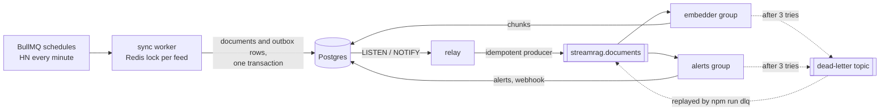

# streamrag

A real-time RAG engine. It keeps a constantly changing knowledge base in sync, searches it with hybrid keyword and vector search plus reranking, and answers questions from it with citations. Run as a streaming pipeline on Kafka, it makes new Hacker News comments searchable a couple of seconds after each one-minute poll finds them. Later phases add agents on top.

It ships with three kinds of sources: engineering blogs and release notes over RSS, Hacker News as a live stream, and a dependency radar that follows the release notes and security advisories of every package in your `package.json`.

Everything runs on free, open-source tools, including the models. Answers come from a model on your own machine through Ollama, and the free tiers of Gemini and Groq can be added as fallbacks.

## What works today (phases 1 to 4)

- Connectors for RSS and Atom feeds, Hacker News (through its Algolia API) and OSV.dev security advisories. The default `sources.json` follows 30 engineering and release blogs plus the latest Hacker News stories and comments, about 5,600 documents on a first run.
- Dependency radar. `npm run track -- path/to/package.json` adds each dependency's security advisories and, when the package lives on GitHub, its release notes.
- Incremental sync. A content hash skips unchanged documents and catches edited ones. Snapshot sources list everything that exists, so whatever they stop listing gets closed. Append-only feeds like RSS and Hacker News keep items open after they roll off. A source that fails to fetch is skipped and left as it was.
- Incremental embedding. Only new or changed documents get re-chunked and re-embedded, a batch at a time, so an interrupted run resumes where it stopped.
- Hybrid search with reranking, measured by an eval set (below).
- Answers with citations. `npm run ask` streams an answer written from the top six search results and lists the sources it cites.
- An LLM gateway with retries, fallback across providers, a circuit breaker and per-minute rate limits. Every model call is logged, and `npm run usage` sums them up.
- A semantic cache. The same question asked again, even lightly reworded, gets the earlier answer back in under a second, as long as the documents it cites haven't changed.
- What breaks when you upgrade. `npm run upgrade -- express 4.21.0 5.0.0` reads the release notes of every major and minor release in between, has the model pull out the breaking changes as JSON, and stores them, so a release is only read once.
- An LLM eval with promptfoo that scores the model on both jobs: cited answers and reading breaking changes out of release notes.
- A streaming pipeline. `npm run pipeline` syncs each source on its own BullMQ schedule, writes every change and its event in one transaction (the outbox pattern), publishes the events to Kafka, and lets consumer groups embed new documents and alert on new security advisories, with a dead-letter topic for events that keep failing.

## Quick start

Needs Node 22.22+ and Docker, plus [Ollama](https://ollama.com) for answers.

```bash
npm install
docker compose up -d                      # Postgres, Redpanda (Kafka) and Redis
npm run migrate
npm run ingest                            # sync, then embed what changed
npm run search -- "how do teams avoid cache stampedes"
ollama pull llama3.2:3b                   # the default answer model, about 2 GB
npm run ask -- "how does Cloudflare D1 scale to millions of databases?"
npm run upgrade -- express 4.21.0 5.0.0   # what breaks between two versions
npm run usage                             # model calls, errors, latency and tokens
npm run track -- ../my-app/package.json   # then run npm run ingest again
npm run eval                              # score every search mode
npm run eval:llm                          # score the model with promptfoo
npm run pipeline                          # keep everything in sync as events; Ctrl+C stops it
npm run status                            # outbox backlog, Kafka lag, dead letters, sync jobs
```

The first `ingest` downloads two small models (about 56 MB, kept in `node_modules`) and embeds every document once. For the default sources that's about 15,000 chunks, which took around half an hour on a 2-core machine and goes faster with more cores. After that, each run only embeds what changed.

`npm run search` takes `--mode keyword|vector|hybrid|rerank` (default `rerank`) and `-n` for the number of results.

Settings live in an optional `.env` file, and `.env.example` lists them: another Ollama model or address, Gemini and Groq keys and the order to try providers in, a GitHub token, the Kafka and Redis addresses, and a webhook for alerts.

## How search works

1. Each document is split into overlapping ~200-word chunks, and every chunk starts with the document's title, so it still says what it's about when retrieved alone.
2. Every chunk gets a 384-dimension embedding from `bge-small-en-v1.5`, stored in pgvector with an HNSW index, and a `tsvector` with a GIN index.
3. A query runs both legs and fuses their rankings with reciprocal rank fusion in one SQL statement. Each leg contributes `1 / (60 + rank)`, so a chunk both legs agree on wins, and raw scores from the two legs, which aren't comparable, never get mixed.
4. A cross-encoder (`ms-marco-MiniLM-L-6-v2`) reads the query together with each of the top 30 chunks and reorders them. It is slower than comparing embeddings but much better at judging relevance.
5. Results come back as documents, each with its best chunk.

Both models run on the CPU through transformers.js, with no API keys.

## How answers work

1. The question goes through the same reranked search. The top six results, one chunk from each document, become numbered sources in the prompt, around 1,700 tokens in all.
2. The model is told to cite every claim as `[n]` and to say so when the sources don't answer the question. The answer streams to the terminal as it's written, and citations to numbers that weren't in the prompt are dropped and reported.

A gateway sits between `ask` and the models:

- It tries providers in the order of `LLM_PROVIDERS`: Ollama first by default, then Gemini and Groq, each only when its key is set.
- A 429, a 5xx or a reset connection gets up to three attempts, with exponential backoff and full jitter, waiting at least as long as `Retry-After` asks. After a bad key, a refused connection or a `Retry-After` over 10 seconds (a free quota that's used up), it moves on to the next provider at once.
- Switching provider is only safe before the first token. Once text has streamed, a failure ends the answer with an error, because a second provider would start the answer over.
- Three failed calls in a row take a provider out of rotation for 30 seconds.
- A sliding one-minute window keeps each free tier under its request limit. A request that would wait more than 2 seconds for a slot goes to the next provider instead.
- Every call, error and skip lands in the `llm_calls` table, which `npm run usage` sums over the last week.

The cache embeds each question and looks for one asked in the last day within cosine distance 0.05. A hit only counts while every document the answer cites is still open with the same content hash, so an edited release note or a withdrawn advisory forces a fresh answer. Answers that cite nothing aren't cached, because "the sources don't say" can stop being true after the next sync.

On the live corpus, a reworded question ("how does cloudflare's D1 scale to millions of databases") was 0.012 away from the cached one and hit. Questions about something else, like "How does Cloudflare D1 handle backups?" or "How does Turso scale to millions of databases?", were 0.18 or more away and missed. A heavier rewording at 0.11 missed too. The threshold is tight on purpose, since a miss costs one model call and a wrong hit serves a confident answer to a different question.

On 2 CPU cores with no GPU, Llama 3.2 3B took about a minute per answer, around 50 seconds of it spent reading the prompt, and a cached repeat took under a second. In test questions it cited its sources whenever it answered from them, and said plainly when they didn't cover the question. Qwen 2.5 0.5B, tried for comparison, never cited anything, so none of its answers could be cached.

Gemini and Groq keys are free to create. Leave billing off on both accounts and they can't charge you. When a free quota runs out, the gateway moves on to the next provider. Google may use what you send to the free Gemini API to improve its products, which is fine for public blog posts but worth knowing.

## What breaks when you upgrade

1. npm supplies the version list and the GitHub repo. The releases to read are the stable majors and minors after the version you're on, up to the one you name (the latest by default). Patch releases are skipped: semver keeps breaking changes out of them, and a big project ships dozens.
2. Release notes come from the repo's releases feed, which carries the newest ten, and older ones from GitHub's API by tag (`v5.0.0`, `5.0.0` or `express@5.0.0`). Without a token the API allows 60 requests an hour, which goes a long way since each release is fetched once; a `GITHUB_TOKEN` raises the limit. Fetched notes are ordinary documents, so the next `ingest` makes them searchable too.
3. The model reads the notes in pieces of up to 4,000 characters, cut between lines, with link targets stripped, since commit URLs are most of the tokens in a changelog. It has to answer with JSON in a fixed schema, `{"breaking": [{"change", "migration"}]}`. Ollama, Gemini, Groq and llama.cpp constrain their output to the schema, the reply gets checked anyway, and one that doesn't parse gets a single retry.
4. The results go into `breaking_changes`, and `extracted_hash` records which version of the notes they came from, the same way `embedded_hash` works for chunks. Edited notes get read again, and nothing else is ever sent to a model twice.

Notes that only point to a changelog file are flagged as too short to judge. Projects that spread a major's breaking changes over its betas only get what the final release's notes say; Express 5 is one of them.

## The streaming pipeline

`npm run ingest` is the batch way in: sync everything, embed what changed, exit. `npm run pipeline` keeps running and does the same work as a stream of events.



1. BullMQ keeps one job scheduler per source in `sources.json`: Hacker News every minute, blogs every 15 minutes, advisories every 6 hours, or whatever an `every` field (in milliseconds) says. A worker syncs one feed per job, at most one a second, and retries a failed fetch with backoff.
2. Each sync first takes a Redis lock on its feed (`SET NX PX` with a random token, released by a Lua compare-and-delete), since two syncs of one feed at once could close each other's documents.
3. The sync writes its documents plus one outbox row for every document it added, changed or closed, in the same transaction. An event exists exactly when its change committed: a failed sync leaves none behind, and none can be lost after a commit.
4. The relay wakes on `pg_notify` from that transaction, and every 5 seconds in case a notification was missed. It publishes the rows with an idempotent producer, keyed by document id so one document's events stay in order, and marks them published. A crash between publishing and marking sends them again, so delivery is at least once and the consumers have to cope with repeats.
5. Two consumer groups read the topic and commit an offset only after handling its event:
   - The embedder embeds the current version of every document the events name, up to 64 at a time. It compares content hashes, so a repeated or outdated event does nothing.
   - The alerts group records each new security advisory once, for feeds past their first sync. An alert isn't naturally repeatable the way an embedding is, so a `processed_events` row is written in the same transaction as the alert. With `ALERT_WEBHOOK_URL` set, the alert goes to Slack or Discord too.
6. An event that fails three times, with backoff, goes to `streamrag.documents.dlq` with its error, and the partition moves on. A failed batch is first redone one event at a time, so only the bad event ends up there. `npm run dlq` lists dead letters, and `npm run dlq -- --replay` sends them back once the bug is fixed; every consumer sees them again, which is safe because every consumer is idempotent.

`--only relay,embedder` runs a subset of the roles, so each can run as its own process, and extra embedder processes split the topic's three partitions between them. `npm run status` shows the outbox backlog, how far behind each group is, the dead letters not yet replayed, and the sync jobs.

On 2 CPU cores, a Hacker News poll that found 28 new comments had them embedded and searchable 2 seconds later. A backlog of about 300 documents went through in batches of 64 at roughly 5 a second, while a local model was busy on the same CPU.

The pipeline tests start Postgres, Redpanda and Redis with Testcontainers and check each of these guarantees, from a failed sync leaving no events to a dead letter replaying exactly once. With a stand-in embedder, a sync commit is searchable about 200 ms later.

## Eval

`npm run eval` starts its own Postgres in Docker, pulls the current OSV advisories for 40 popular npm packages, embeds them, and asks 56 questions in every mode. The questions are written the way a developer would ask them, mostly without the advisory's own wording, and each lists the advisories that answer it. A few are bare CVE IDs, which keyword search is good at and embeddings are not.

Results on 557 advisories, October 2026:

| mode | recall@1 | recall@5 | recall@10 | MRR@10 |
|---|---|---|---|---|
| keyword | 0.11 | 0.14 | 0.14 | 0.13 |
| vector | 0.88 | 0.91 | 0.95 | 0.89 |
| hybrid | 0.88 | 0.96 | 1.00 | 0.91 |
| rerank | 0.88 | 0.98 | 1.00 | 0.92 |

Recall@k is the share of questions whose answer shows up in the top k results. MRR rewards putting it first. The corpus grows as new advisories are published, so the numbers move a little over time.

Keyword search on its own needs every word of a question in one chunk, so it rarely finds an answer to a natural question. Inside hybrid search the strictness helps: it fires on exact names and IDs, which the vectors miss, and lifts recall@10 from 0.95 to 1.00.

Two changes the eval decided:

- Matching any word instead of all of them lifted keyword search alone from 0.14 to 0.77 recall@10, but dropped hybrid from 1.00 to 0.93 and its MRR from 0.91 to 0.74, because fusion trusts a noisy leg as much as a precise one. It was reverted.
- The reranker pushed bare CVE IDs out of the top 10, since it was trained on natural questions. Queries that look like an identifier now keep the hybrid order, which brought rerank's recall@10 from 0.96 to 1.00. Those IDs still land at ranks 2 to 4 rather than first.

### LLM eval

`npm run eval:llm` uses promptfoo to score the model on the two jobs it has:

- Answers: eight of the questions above, over the same advisories, plus two that no npm advisory can answer. An answer passes when it cites an advisory that answers the question and no source number it wasn't given. For the two unanswerable questions, it passes by citing nothing.
- Extraction: four changelog sections pinned at release tags. Express 5.0.0 and ESLint 9.0.0 have breaking changes the model should find; the patch releases Express 5.0.1 and 4.21.1 have none.

Llama 3.2 3B, October 2026:

| suite | passed | score |
|---|---|---|
| answers with citations | 9/10 | 0.95 |
| breaking changes from release notes | 4/4 | 1.00 |

The one miss cited a different follow-redirects advisory than the one the question describes.

The first extraction run passed 2 of 4. The model called a CVE fix in Express 5.0.1 breaking, and listed a single item for ESLint 9, which has 38 breaking changes, because a small model copies long lists badly. Two changes followed:

- The prompt now says security fixes don't count either, unless the notes say behavior changes. That fixed Express 5.0.1.
- Lines that conventional commits mark as breaking (`feat!:`, `BREAKING CHANGE:`) are taken straight from the notes, and the model only judges the rest. ESLint 9 passed after that, and the run got a third faster.

`EVAL_MODELS=llama3.2:3b,qwen2.5:7b npm run eval:llm` compares models side by side, `npm run eval:llm -- extraction` runs one suite, and `cd eval/llm && npx promptfoo view` shows every answer. promptfoo ships SDKs for dozens of model providers as optional packages, over 1 GB of them, so it lives in `eval/llm` with its own `package.json` and installs without them, at about 280 MB.

## How it's built

```
src/
  core/         storage, sync, chunking, embedding, search, answers and extraction (Postgres + pgvector)
  connectors/   one file per source type: rss, hackernews, osv
  llm/          the gateway, a streaming client for OpenAI-compatible APIs, provider settings
  pipeline/     schedules and locks (BullMQ, Redis), the outbox relay, consumers and dead letters (Kafka)
  track.ts      turns a package.json into sources
  upgrade.ts    finds the releases an upgrade crosses and their notes
  cli.ts
  eval.ts       the retrieval eval
db/schema.sql
eval/queries.json
eval/llm/       the promptfoo eval, with its own package.json
```

- Every source lands in one `documents` table, keyed by `(source, feed, external_id)`. Retrieval works on a `chunks` table.
- A sync is one batch upsert (`unnest` + `ON CONFLICT`) in one transaction. `now()` is fixed for the whole transaction, so the rows the sync touched show up as `= now()`, and a snapshot sync closes everything else in that same transaction.
- `embedded_hash` records which version of a document its chunks came from, so changed documents get picked up again and nothing else does. `extracted_hash` does the same for breaking changes.
- Vector search uses pgvector 0.8's iterative index scans, so filtering out closed documents can't leave a result list short.
- The cache is a table too. Each row of `answers` keeps the question's embedding (HNSW-indexed), the numbered sources with their content hashes, and which of them the answer cited.
- Ollama, Gemini and Groq all offer an OpenAI-compatible chat API, so one small client (`fetch` plus a server-sent events parser) covers all three without an SDK.
- Fetching is polite: one request a second, an identifying User-Agent, public endpoints only.
- The tests run against real Postgres, Redpanda and Redis through Testcontainers, locally and in GitHub Actions, with stand-in models, a scripted gateway and faked npm and GitHub responses, so CI downloads no model and calls none.

## Roadmap

1. Core sync, full-text search, RSS, Hacker News and the dependency radar (done)
2. Embeddings with pgvector, hybrid keyword + vector search, reranking, and an eval set that measures retrieval quality (done)
3. LLM layer: a gateway across local Ollama, Gemini and Groq with rate limits, retries, fallback and a circuit breaker, a semantic cache, streamed answers with citations, breaking changes pulled out of release notes as JSON, and a promptfoo eval (done)
4. Event pipeline: Kafka (Redpanda) with Hacker News as the live stream, the outbox pattern, idempotent consumers, a dead-letter topic, BullMQ schedules and Redis locks (done)
5. Media connector: FFmpeg and Whisper turn dev podcasts and conference talks into timestamped, searchable text, and answers link to the exact moment
6. APIs: GraphQL, streamed answers, a LangGraph agent and an MCP server, so coding assistants can ask about your dependencies
7. Web dashboard (Next.js) with live updates
8. Observability and load testing: OpenTelemetry, Langfuse, Prometheus, Grafana, k6 and Playwright

## Data

Posts, release notes, advisories and Hacker News items come from public feeds and APIs. streamrag stores them for search and links back to each original. It doesn't republish them.
